# Deskbot — Android body for a Hermes Agent desk robot

A dedicated, rooted Android phone becomes a desk robot. **Hermes Agent** (running in Termux on the same phone) is the brain. This app is the body: a full-screen animated face or 3D avatar, a voice loop, camera, screen control and ~110 phone tools that Hermes calls through a local bridge.

```
Hermes (Termux) --deskbot-phone plugin--> Bridge 127.0.0.1:8643 --> Android app (~110 tools)
Android app --OpenAI-compatible API (SSE)--> Hermes 127.0.0.1:8642 (chat, images, local time context)
```

| | |
| --- | --- |
| 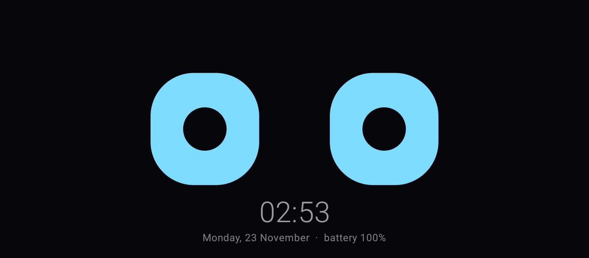 | 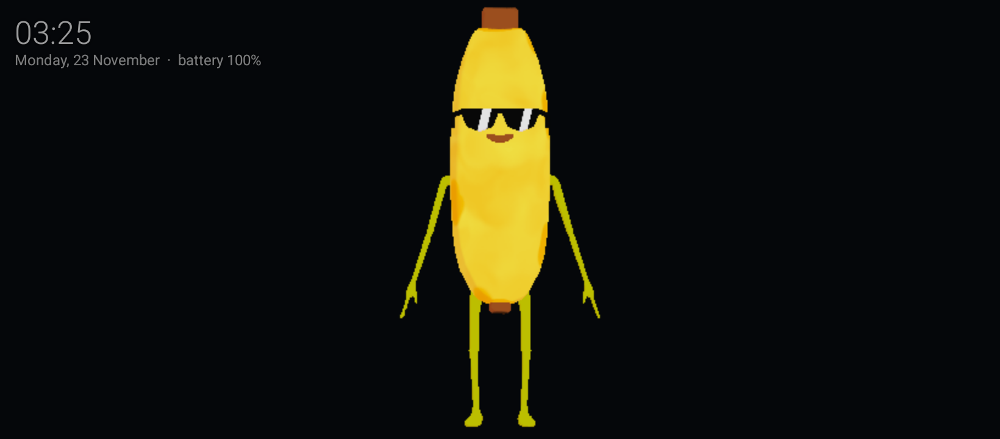 |
| The face is the whole app: full screen, time, date and battery on it. | A VRM avatar can be the face instead. |

## Contents
- [Screenshots](#screenshots) · [What it does](#what-it-does) · [Quick start](#quick-start) · [Docs](#docs)
- [Architecture](#architecture) · [Testing](#testing-and-verification) · [Safety](#safety) · [Status](#status)

## Screenshots
Everything below was captured from the real phone.

| Happy | Love | Cry reaction |
| --- | --- | --- |
| 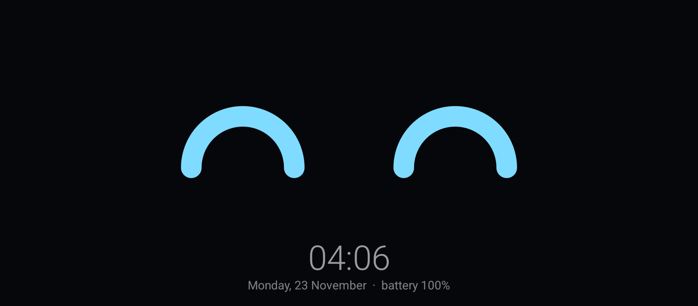 | 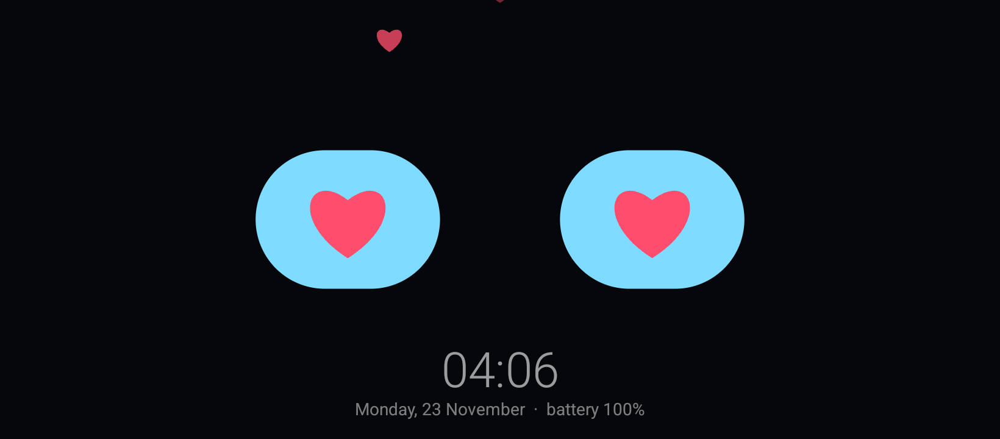 | 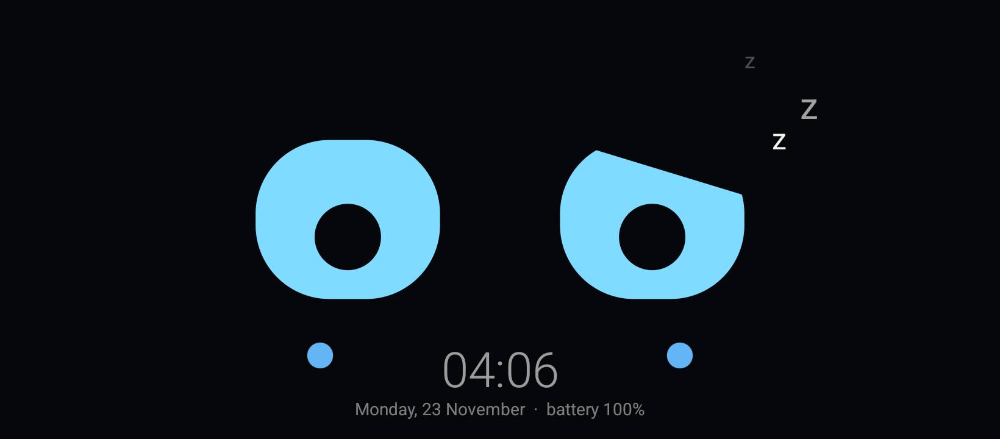 |

| Angry | A card Hermes built (generative UI) | Hermes posed the avatar itself |
| --- | --- | --- |
| 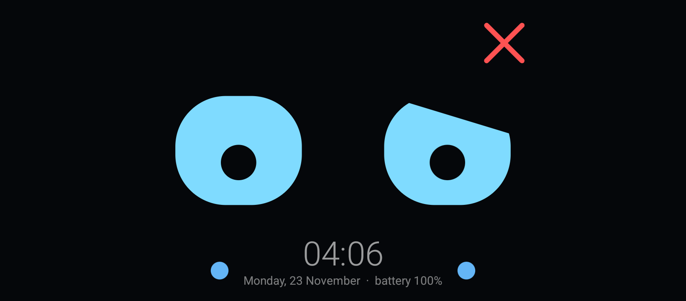 | 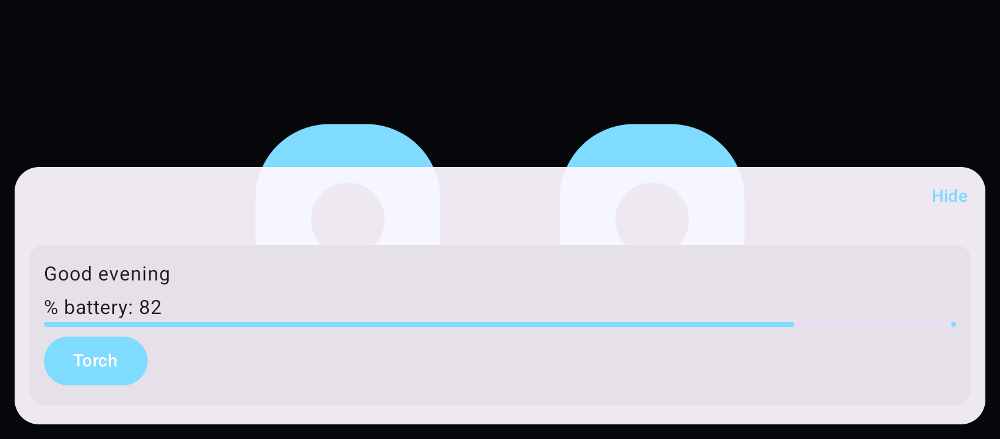 | 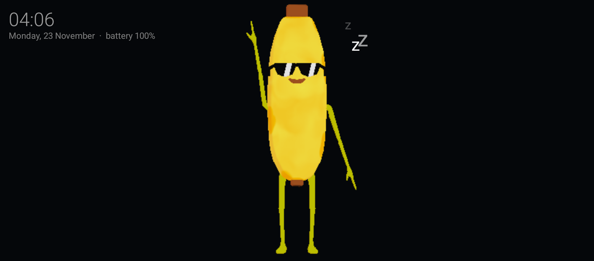 |

| Avatar blushes when tapped | Tears (cry reaction) | Hearts (love mood) |
| --- | --- | --- |
| 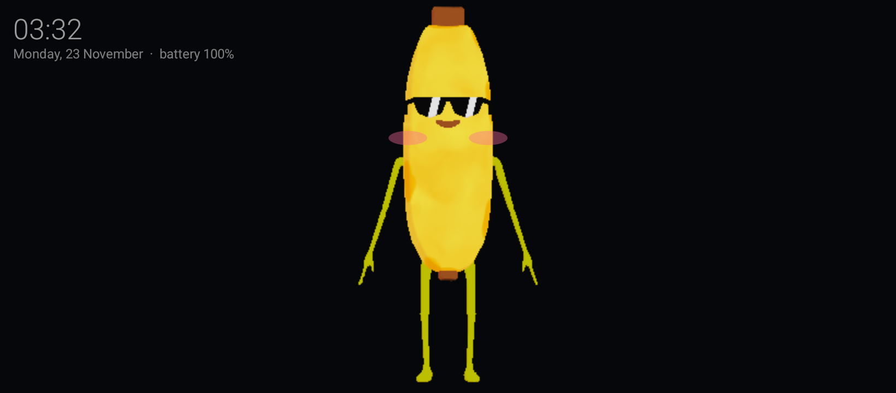 | 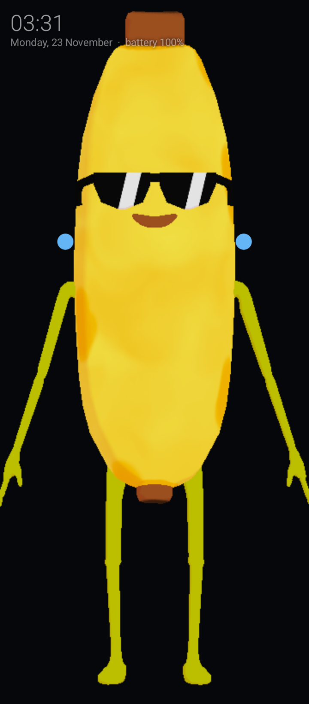 | 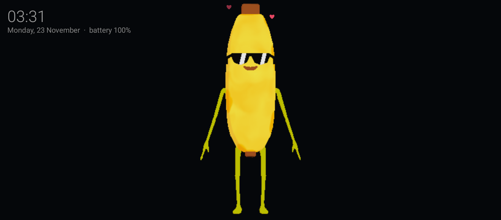 |

| Agent-written pose (no built-in motions) | Agent keyframe animation | VRM animation clip |
| --- | --- | --- |
| 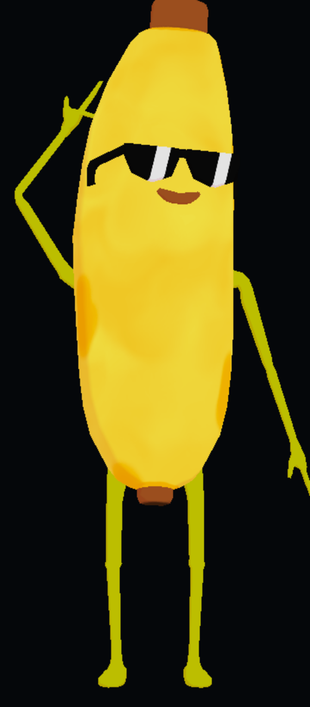 | 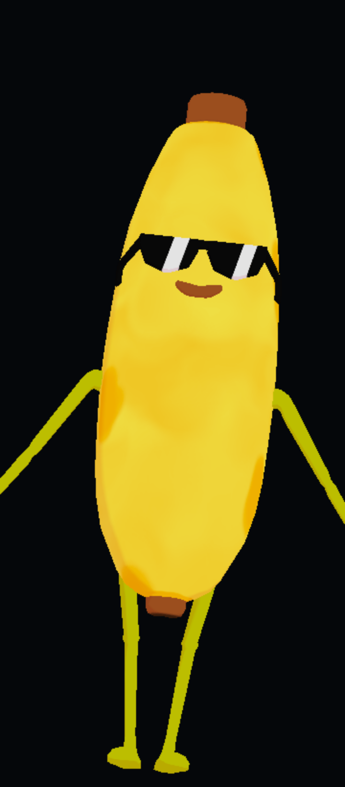 | 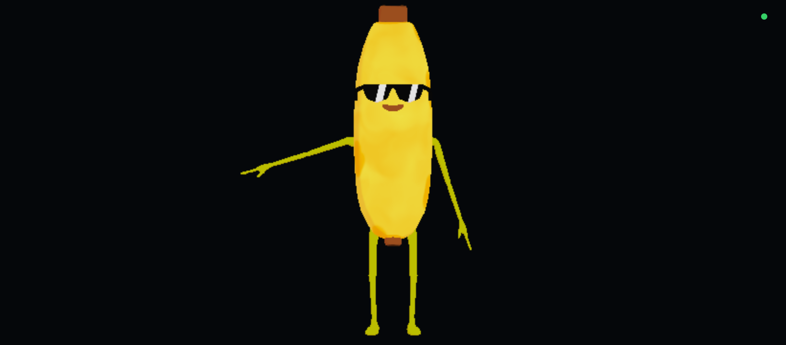 |

| Avatar catalog (OpenSourceAvatars) | Avatar library: installed, optimized, removable |
|---|---|
| 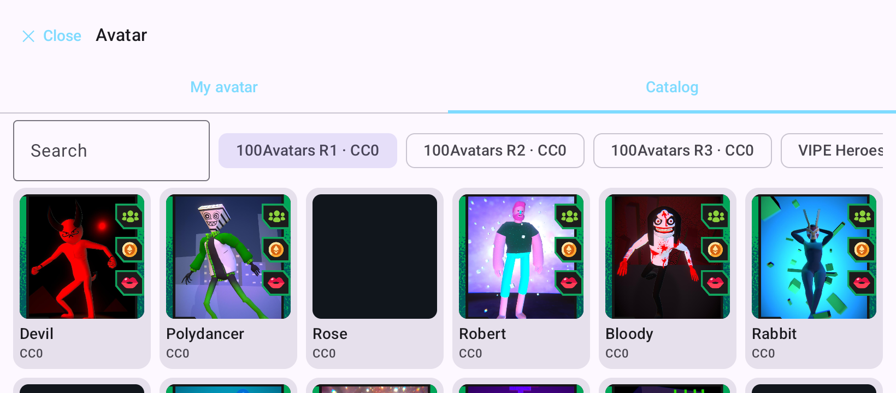 | 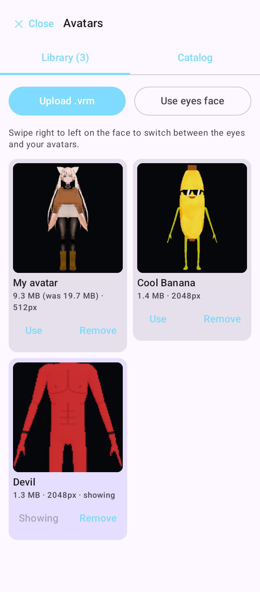 |

| Hidden menu (swipe in from the left) | Voice screen |
|---|---|
| 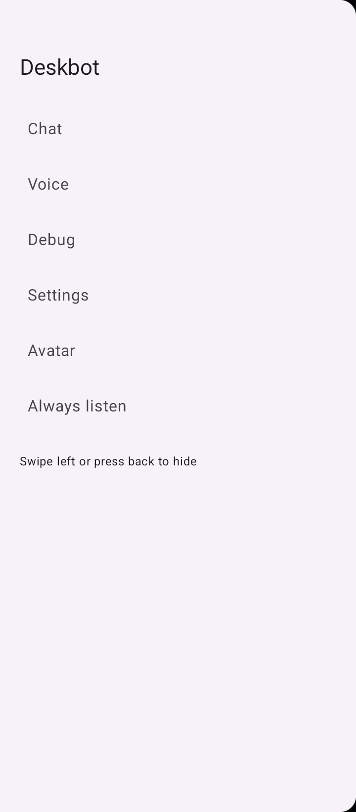 | 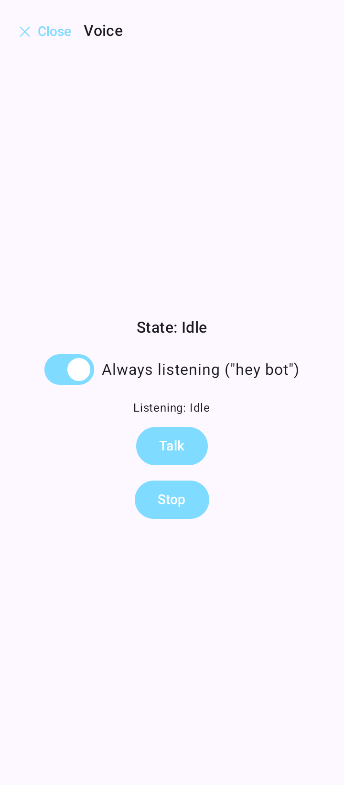 |

| Floating face bubble over other apps | Picture-in-picture face | Annotation overlay |
| --- | --- | --- |
| 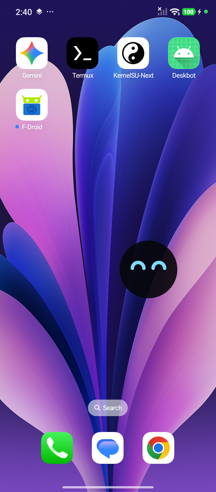 | 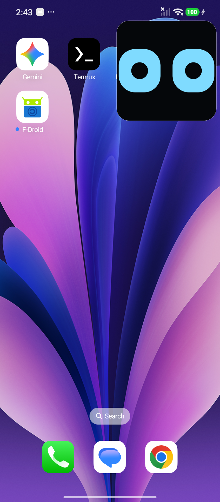 | 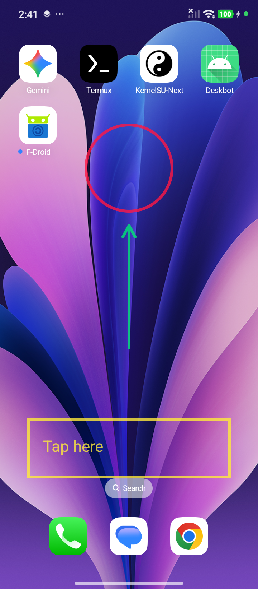 |

## What it does
The complete list, with the status of every one of the 384 catalogued features and every bridge tool, is in **[docs/FEATURES.md](docs/FEATURES.md)**. In short:

**Face and presence**
- Fullscreen eyes face: 15 moods, 18 reactions, effects (tears, blush, hearts, sparkles, zzz), personas, `<expr .../>` tags in Hermes replies, idle behaviours, night sleep, touch reactions, quick actions (long-press), clock/date/battery.
- Lip sync: the mouth follows the words being spoken.
- Floating face bubble, picture-in-picture face, on-screen annotation overlay (circles, boxes, arrows, labels), lock-screen display.
- Presence: counts faces (no identity, frame discarded), eyes follow a detected face, arrival/departure fusion of camera, sound, motion and visual change, spoken greeting on arrival.

**3D VRM avatar**
- **Avatar library + swipe**: the *Avatars* screen lists every installed avatar (thumbnail, optimized size, Use / Retry / Remove) and *Upload .vrm* adds one. **Swipe right-to-left on the face** to step through the eyes and your avatars; only the active avatar and the next one are kept in memory (the next is staged in the same WebView, so a swap takes about 40-90 ms), and imported models are optimized (big textures re-encoded smaller) and stored in Room. The *Catalog* tab browses the free [OpenSourceAvatars](https://www.opensourceavatars.com) registry (collections, search, previews); tap a model to download and use it. The agent can do the same with `avatar_catalog` and `avatar_download`.
- Big models work: textures are shrunk while loading (the app picks 2048/1024/512/256 px from the model's estimated GPU memory), so a 20 MB VRM with 4K textures renders on a 3.5 GB phone. Models over 50 MB or with absurdly many textures are refused, and a model that still kills the app is rolled back automatically.
- Catalog downloads are licence-checked (CC0, CC-BY, CC-BY-SA, VRM "everyone"; others are refused). Your own uploaded files skip the licence rule but must still be valid VRM files. The model is shown as the face, and the agent can move **any bone or node** (`avatar_bones`, `avatar_pose`, `avatar_animate`); there are no preset motions. Imports and plays `.vrma` clips. Emotion effects, tap reactions, lip sync and gaze work on it too.

**Voice**
- Wake word ("Hey bot", offline Vosk), speech-to-text, Hermes streaming reply, sentence-chunked text-to-speech, barge-in ("stop"), vision on demand ("what is this?" attaches a camera frame), kill phrase.

**Phone control for the agent (bridge tools)**
- Screen and input: accessibility tree, tap, swipe, drag, type, back/home, screenshot, highlight, wait-for.
- Apps and system: open/stop/list apps, settings read/write, radios, volume, brightness, torch, vibrate, alarms, timers, clipboard, share target, intents, root shell (deny-listed and audited).
- Notifications: read, history, one-time codes, post. Calendar, contacts, location, places and geofences, sensors, ambient light.
- Camera, microphone level, visual and sound watchers, motion detector.
- Files, archives, hashes, notes, downloads, LAN scan, Wake-on-LAN, DNS, port check, MQTT, HTTP, local folder server.
- Routines (event → tool calls), macros (record and replay), self-test, health score, safe mode, kill switch.

**Generative UI (A2UI)**
- Hermes composes native cards, forms, toggles, sliders, gauges and timers on the face screen; they expire after a time or after an action.

**Hermes skills**
- 384 skill sections in 30 skill folders (`hermes-skills/deskbot`), one per feature in `docs/Feature catalog.md`, each with the exact tools and a verify step.

## First run and production polish
- **First-run introduction** (skippable, shown once, replay from Settings): what Deskbot is, grouped permission explanations (microphone, camera, notifications) and a Hermes *Test connection* button.
- **Last crash** in Debug: the app records uncaught exceptions to a size-capped file with secrets redacted; view, copy or clear it from the hidden menu.
- **Avatar library states**: loading, empty (Upload / Browse catalog), inline import errors, BROKEN entries with Retry and Remove, success messages.
- **Settings**: Display quality (Auto, Low, High) and an About block.
- **Accessibility**: content descriptions, 48 dp targets, live announcements for mood and Hermes status, font-scale friendly.
Details in [docs/SETUP.md](docs/SETUP.md).

## Quick start
With a rooted phone that has Termux and Hermes, connected over adb:

```sh
./scripts/setup_device.sh
```

This builds and tests, installs the app, applies permissions, installs the Hermes skills, sets up the Termux scripts and packages (`openssh rsync ffmpeg nmap tesseract`) and syncs the bridge token. Then restart the Hermes gateway so it sees the tools. The full walkthrough, safety notes and troubleshooting table are in **[docs/SETUP.md](docs/SETUP.md)**.

## Docs
| Doc | What |
| --- | --- |
| [docs/SETUP.md](docs/SETUP.md) | Setup guide: prerequisites, install, Hermes link, Termux extras, safety, troubleshooting |
| [docs/guides/](docs/guides/README.md) | How-tos: open the Hermes dashboard from your PC (USB tunnel or SSH tunnel), with each step explained |
| [docs/FEATURES.md](docs/FEATURES.md) | Every feature and bridge tool by skill group, with status (generated) |
| [docs/Feature status.md](docs/Feature%20status.md) | Per-feature status table (generated) |
| [docs/Feature catalog.md](docs/Feature%20catalog.md) | The 384-feature catalog |
| [docs/Architecture.md](docs/Architecture.md) | Architecture and where a new capability goes |
| [docs/Tab 1.md](docs/Tab%201.md) | The original project plan |
| [CLAUDE.md](CLAUDE.md) | Module rules, SOLID and patterns, testing policy, Hermes contracts |
| [THIRD_PARTY.md](THIRD_PARTY.md) | Libraries and bundled code with licences |

## Architecture
Multi-module clean architecture; dependencies point inward.

| Path | What |
| --- | --- |
| `app/` | Wiring only: DI container, tool catalog, immersive face UI, foreground service, boot receiver, share target |
| `core/domain` | Pure Kotlin: use cases, ports, capabilities (tools), face/persona engine, avatar pose model, A2UI model, routines, safety |
| `core/network` | Hermes client (SSE), bridge server and protocol, HTTP/LAN/MQTT/download tools |
| `core/data` | Android adapters: accessibility, notifications, camera, speech, wake word, sensors, overlays |
| `core/testing` | The one shared set of fakes |
| `engine/vrm` | The in-house VRM engine, pure Kotlin and JVM-tested: GLB/VRM 0.x and 1.0 parser (compact vertex packing, sparse morph targets), rig, pose/animation driver, VRMA clips, spring-bone physics, model slots (active + staged), frame pacing, memory policy |
| `engine/vrmgl` | The OpenGL ES 3.0 side: toon shader variants, GPU upload, RGB565 textures, bone-texture skinning for GPUs with few uniforms, the GL view |
| `feature/face` `chat` `voice` `settings` `a2ui` `avatar` | Compose screens; the avatar module drives the native VRM engine (no WebView, no JavaScript) |
| `hermes-skills/` | The Hermes skills and `tools.txt` |
| `scripts/` | Setup, permission grants, Termux scripts, verification harnesses, doc generators |

Patterns in use: ports and adapters, strategy and decorator (deny-list and audit around the shell), registry (capabilities, A2UI components), command (macros), state machine (bot state), observer (StateFlow).

## Testing and verification
```sh
./gradlew test testDebugUnitTest assembleDebug     # JVM domain tests + Android unit tests + build
python3 scripts/verify_recipes.py                   # runs read-only skill recipes on the phone (needs the app's bridge up)
python3 scripts/verify_hermes.py                    # real Hermes agent tasks end to end (15 of 16 pass)
python3 scripts/gen_feature_status.py && python3 scripts/gen_docs.py   # regenerate the status and feature docs
sh scripts/avatar_stress.sh "/sdcard/Download/Big.vrm" 3                 # import a model N times, check the app survives (needs the phone)
sh scripts/avatar_golden.sh <library-id> <name>                       # pose the avatar and compare screenshots with docs/golden (needs the phone)
sh scripts/termux/test_watchdog_lib.sh                                # watchdog decision logic (any machine)
```
`FeatureCoverageTest` enforces that every catalog number has exactly one skill section and that every tool a skill names exists.

## Safety
Kill switch (phrase, volume-down ×3, tool; only the user resets it on the phone), shell deny-list, audited tool calls, crash-loop safe mode, no multi-stroke gestures on Xiaomi hardware, secrets never in the repo or logs. Details in [docs/SETUP.md](docs/SETUP.md#8-safety).

## Status
384 catalogued features: **116 built**, **126 recipe verified**, **28 partial**, **101 recipe only**, **13 blocked** (hardware or modules this phone lacks). Most recipe-only features need other apps or accounts; most partial ones need a real person in front of the camera to confirm. See [docs/Feature status.md](docs/Feature%20status.md).

## Licence
Application code: see the repository. Third-party libraries and bundled files are listed with their licences in [THIRD_PARTY.md](THIRD_PARTY.md).
